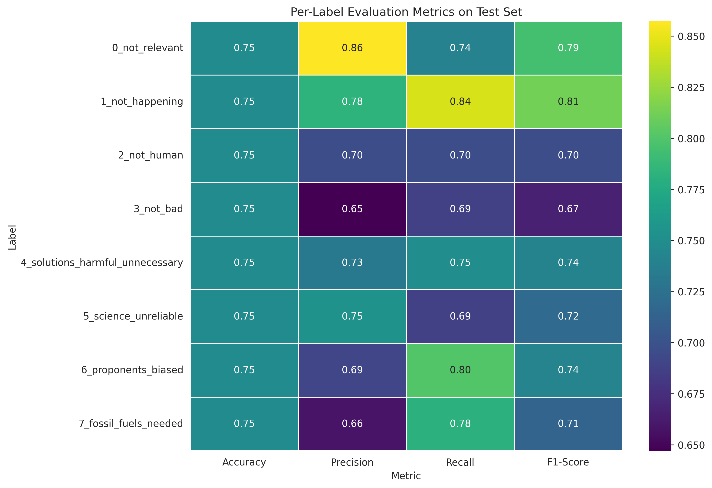

# Climate Skepticism Text Classification

A fine-tuned language model for multi-label climate skepticism classification using the Frugal AI Challenge dataset.

## Project Overview

This project develops a text classification model to categorize climate-related arguments into 8 different skeptical argument categories. The model uses parameter-efficient fine-tuning with LoRA (Low-Rank Adaptation) on RoBERTa-Large to keep computational costs low while maintaining competitive performance.

## Dataset

**Name:** [Frugal AI Challenge](https://huggingface.co/datasets/QuotaClimat/frugalaichallenge-text-train)  
**Source:** QuotaClimat / Hugging Face Datasets

**Classification Labels:**
- `0_not_relevant` - Content not related to climate change
- `1_not_happening` - Climate change is not happening
- `2_not_human` - Climate change is not caused by humans
- `3_not_bad` - Climate change impacts are not negative/exaggerated
- `4_solutions_harmful_unnecessary` - Climate solutions are harmful or unnecessary
- `5_science_unreliable` - Climate science is unreliable
- `6_proponents_biased` - Climate advocates are biased
- `7_fossil_fuels_needed` - Fossil fuels are necessary

## Model Architecture

**Base Model:** `roberta-large`  
**Fine-tuning Method:** LoRA (Low-Rank Adaptation)

### LoRA Configuration

```python
LoraConfig(
    task_type=TaskType.SEQ_CLS,
    r=8,                           # LoRA rank
    lora_alpha=16,                 # Scaling factor
    init_lora_weights="gaussian",
    lora_dropout=0.1,
    target_modules="all-linear"    # Apply LoRA to all linear layers
)
```

## Training Configuration

### Hyperparameters

```python
num_train_epochs: 8
per_device_train_batch_size: 2
per_device_eval_batch_size: 4
gradient_accumulation_steps: 4
weight_decay: 0.01
warmup_steps: 20
learning_rate: 5e-5 (default)
lr_scheduler_type: linear
```

### Training Strategy

- **Optimizer:** AdamW
- **Precision:** bfloat16 (if supported) / fp16
- **Evaluation Strategy:** Every epoch
- **Save Strategy:** Every epoch (keep best 1 model)
- **Loss Function:** Weighted Cross-Entropy (balanced weights)

### Early Stopping

```python
EarlyStoppingCallback(
    early_stopping_patience=2,      # Stop after 2 epochs without improvement
    early_stopping_threshold=0.005  # Minimum improvement threshold
)
```

## Results

### Overall Test Set Performance

| Metric | Value |
|--------|-------|
| **Accuracy** | 0.7475 |
| **Precision** | 0.7535 |
| **Recall** | 0.7475 |
| **F1-Score** | 0.7483 |
| **Loss** | 0.8260 |

### Per-Label Evaluation Metrics



#### Detailed Per-Label Performance

| Label | Accuracy | Precision | Recall | F1-Score |
|-------|----------|-----------|--------|----------|
| **0_not_relevant** | 0.7475 | 0.8571 | 0.7403 | 0.7944 |
| **1_not_happening** | 0.7475 | 0.7831 | 0.8442 | 0.8125 |
| **2_not_human** | 0.7475 | 0.6957 | 0.6957 | 0.6957 |
| **3_not_bad** | 0.7475 | 0.6471 | 0.6875 | 0.6667 |
| **4_solutions_harmful_unnecessary** | 0.7475 | 0.7317 | 0.7500 | 0.7407 |
| **5_science_unreliable** | 0.7475 | 0.7534 | 0.6875 | 0.7190 |
| **6_proponents_biased** | 0.7475 | 0.6914 | 0.8000 | 0.7417 |
| **7_fossil_fuels_needed** | 0.7475 | 0.6579 | 0.7813 | 0.7143 |

### Key Findings

- **Best Performing Labels:** 
  - `1_not_happening` (F1: 0.8125) - High precision and recall
  - `0_not_relevant` (F1: 0.7944) - Excellent precision (0.8571)
  
- **Lower Performing Labels:**
  - `3_not_bad` (F1: 0.6667) - Likely due to class imbalance or ambiguous examples
  - `2_not_human` (F1: 0.6957) - Moderate performance

- **Balanced Performance:** The model maintains consistent accuracy across all labels due to weighted loss training strategy

## Training Dynamics

```
Epoch	Training Loss	Validation Loss	Accuracy	Recall	Precision	F1
1	4.796509	0.815203	0.725780	0.725780	0.737214	0.724300
2	2.887393	0.863184	0.729064	0.729064	0.741933	0.726515
3	2.182435	0.851537	0.742200	0.742200	0.749447	0.741744
4	1.676231	0.809233	0.765189	0.765189	0.774387	0.766757
5	1.227654	0.972264	0.747126	0.747126	0.749622	0.746471
6	0.915558	1.036352	0.763547	0.763547	0.764963	0.763767
```

The model shows steady improvement through epochs 1-4, with best F1 score achieved at epoch 4 before slight overfitting signals at epochs 5-6.

## Model Deployment

**Hugging Face Model:** [Francesco-A/climate-skeptic-frugalai-roberta-large-multiclass-LoRA-v1.1](https://huggingface.co/Francesco-A/climate-skeptic-frugalai-roberta-large-multiclass-LoRA-v1.1)

<!-- ### Inference Example

```python
from transformers import AutoTokenizer, AutoModelForSequenceClassification
import torch

model_id = "Francesco-A/climate-skeptic-frugalai-roberta-large-multiclass-LoRA-v1.1"
tokenizer = AutoTokenizer.from_pretrained(model_id)
model = AutoModelForSequenceClassification.from_pretrained(model_id)

text = "Climate change is not happening"
inputs = tokenizer(text, return_tensors="pt")
outputs = model(**inputs)
predictions = torch.argmax(outputs.logits, dim=-1)
``` -->

## Repository Structure

```
.
├── README.md                           # This file
├── notebooks/
│   └── 01_train_eval.ipynb            # Training and evaluation notebook
├── src/
│   ├── config.py                      # Configuration management
│   ├── utils/
│   │   ├── generic.py                 # Generic utilities
│   │   └── train.py                   # Custom training components
│   └── __init__.py
├── data/                              # Datasets
├── results/                           # Model checkpoints
├── evals/
│   ├── images/                        # Evaluation visualizations
│   └── tables/                        # Evaluation metrics (CSV)
├── requirements/
│   ├── core.txt                       # Core dependencies
│   └── train_eval.txt                 # Training dependencies
└── snapshots/
    └── 01_train_eval.txt              # Full pip freeze snapshot
```

## Requirements

Install dependencies using:

```bash
pip install -r requirements/train_eval.txt
```

**Key Dependencies:**
- transformers
- peft (for LoRA)
- datasets
- torch
- peft
- evaluate
- trackio (for experiment tracking)

See `snapshots/01_train_eval.txt` for full environment snapshot.

## Usage

### Training

Run the Jupyter notebook [notebooks/01_train_eval.ipynb](notebooks/01_train_eval.ipynb) with appropriate configuration flags:

```python
DEVICE = "cuda" if torch.cuda.is_available() else "cpu"  # Use GPU if available
MAKE_BINARY = False           # Multiclass classification
PUSH_TO_HUB = True            # Push to Hugging Face Hub
SAVE_LOCAL = False            # Save model locally
SMOKE_TEST = False            # Run a quick test with a small subset of data
VALIDATION_ONLY = False       # Skip training and only run validation
WEIGHT_STRATEGY = "none"      # Updated later in the code with `check_weight_strategy()`
```

### Evaluation

Evaluation is automatically performed at the end of training on the test set. Results are saved to `evals/tables/label_metrics.csv` and visualized as a heatmap in `evals/images/`.

## Experiment Tracking

Experiments are tracked using **TrackIO** with project name: `ClimateSkepticism`

## Future Improvements

- Investigate lower-performing labels (3_not_bad, 2_not_human) with data augmentation
- Experiment with larger LoRA ranks or additional parameters
- Try different base models (e.g., RoBERTa-XLarge, Mistral)
- Implement ensemble methods for improved robustness
- Add confidence thresholds for production deployment

## License

MIT
